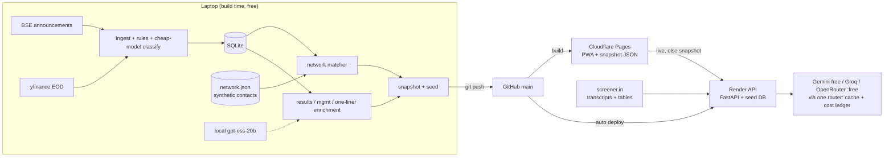

# FINN architecture: pipelines, privacy, models and agents, cloud

One page for the writeup. Diagram first, then the four topics the brief asks for.

## 1. Data pipelines
| Source | Fetched | Refreshed | Stored | Linked by |
|---|---|---|---|---|
| BSE filings | `scripts/ingest` on the laptop (BSE blocks cloud IPs), 1 req/s | on demand, incremental | `filings` (SQLite) | NSE symbol + BSE scrip code (`data/portfolio.json`, verified against BSE company names) |
| Prices | yfinance end-of-day | with ingest | `bars` | NSE symbol |
| Fundamentals | screener.in tables and transcript links, any NSE ticker, live on the API | once per document, cached by content | `documents`, `doc_pages`, `research_cache` | symbol, call period |
| Network profiles | `data/network.json`: **synthetic** people (the real source would be a consented profile export or a licensed profile API) | edited in the repo (demo); a real product would have an import and edit screen | read-only file | person to company by NSE symbol on each job; person to filing by the rules below |

**Matching a name in a filing to a person in the network** (`app/network.py`, no model involved):
1. A management filing gives a `BioCard` (name, role, effective date, background lines, all verified against the filing text).
2. If the filing states tenure ("since 2002", "22 years with HDFC Group"), contacts whose job at that company overlaps those years are `overlapped_with_person`, with the overlap in years. FINN never guesses a tenure.
3. If the filing names a school that a contact attended, that is `same_school`.
4. Otherwise it matches on the employer (`worked_at_company`) or on expertise (`sector_expert`) and the card says "matched on the employer only".
5. Every match carries `evidence`, the facts it rests on.
Warm nudges join contacts to filings of their former employers (last 14 days, not spoken to for 45+ days).

## 2. Data security and privacy
What the demo does: the network is **synthetic** and flagged `synthetic: true` in every response; no real person's profile is stored. Because it is synthetic, the demo deliberately does **not** protect it: `data/network.json` is in the public repository, the snapshot copies are static files on a public CDN, and the `/network/*` API routes need no login. That would be unacceptable for real contacts, which is why the deployment plan below differs. Filing people appear only with what the filing itself says. The Profile name lives in the browser's localStorage and is never sent to the server. No analytics, no cookies, keys only in server env.
What a real deployment would do:
- **Ownership and access:** no real network is ever shipped in a repository or a static file; one network per investor, rows keyed by `owner_id`, every query filtered by the authenticated owner (row-level security); other users, and FINN staff by default, cannot read it.
- **Consent:** contacts are the investor's own data. Third-party profile fields come only from a source with a licence or from the person's consent; nothing is scraped against a platform's terms. A person can ask to be removed, which deletes their node and every derived match.
- **Minimisation and retention:** store role, employer, tenure, school, expertise tags and relationship metadata, not messages or contact details; profile data refreshed or deleted after 12 months without use; the export button and "delete my network" are one tap.
- **LLM exposure:** the only text sent to a model for the Network is the user's question (including any name the user types) and the list of tracked company names; the contacts themselves are never put in a prompt. Models are free-tier APIs plus a local model, no training on the data.
- **At rest and in transit:** HTTPS everywhere, encrypted database volume, secrets in the host's env store, audit log of reads of network data.

## 3. Models and agents
| Step | Model | Why |
|---|---|---|
| Filing category | rules first (84.6% of 468 filings), then one cheap model call per 30 filings | cost: rules are free |
| Results cards | Gemini reading the PDF natively, code does all arithmetic, cross-checked against screener.in | models misread tables, code does not mis-add |
| Management bio, one-liners | cheap model, every name and number verified against the filing text | no invented people or figures |
| Guidance extraction, promised vs delivered | stronger models, judged against quotes checked on the page; computed checks for closed years | grounding: no quote, no claim |
| Network matches, warm nudges, expertise map | **no model** | rules over listed facts, explainable |
| `/ask` and the Network question box | small **agent**: a model plans (picks one tool and its argument), code runs the tool, the answer is assembled from the tool's results | the agent can plan and call tools but cannot name anyone who is not in the network; `steps` are shown to the user; a rules planner takes over if no model answers |

One router (`run_task`) handles tiers, fallbacks, circuit breaking, an answer cache and the cost ledger: 195 calls, 54% cache hits, ₹0. Agents never act on their own: nothing is sent, booked or changed; they only read.

## 4. Cloud services
| Where | What | Why |
|---|---|---|
| Laptop | BSE ingest, enrichment with a local GPU model, snapshot export | BSE blocks cloud IPs; local model has no quota |
| GitHub | source, seed database, snapshot | the deploy trigger |
| Render (free, Docker) | FastAPI, restores the seed database on every boot; live research for any ticker | needs a server for LLM calls and screener.in |
| Cloudflare Pages | PWA and snapshot JSON | static, global, works when the API sleeps |
| Gemini / Groq / OpenRouter free tiers | all in-app model calls | cost: nothing paid |
